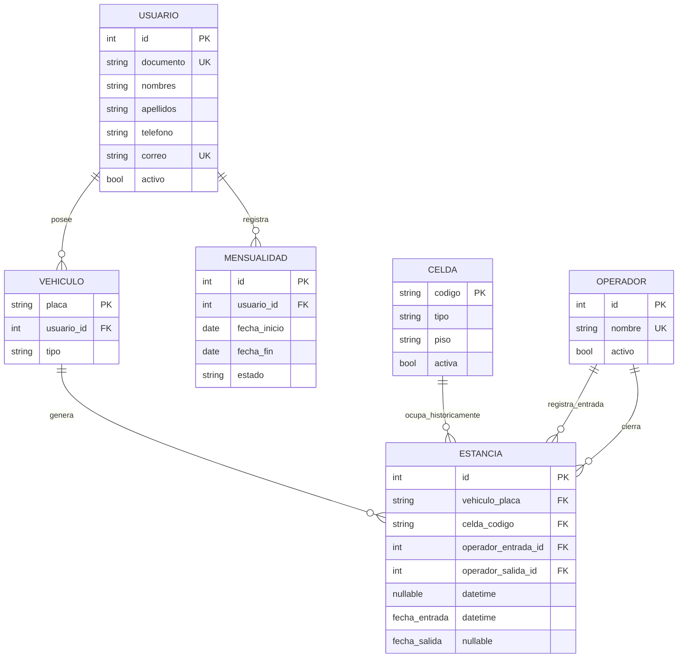
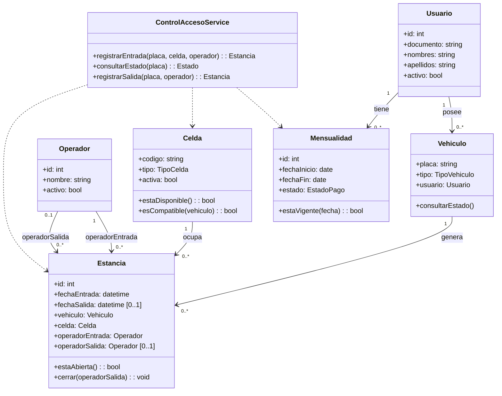
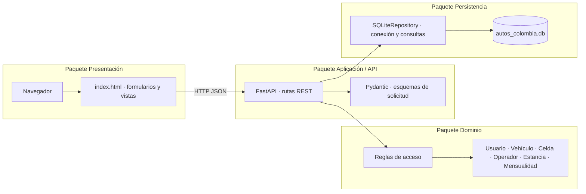

# Autos Colombia — correcciones de Iteración 2

**Autora:** Paula Andrea Celis Cano  
**Propósito:** incorporar la retroalimentación sobre integridad de datos, reglas de ingreso y consistencia de diagramas.

## Cambios del sistema

- `vehiculos.usuario_id` relaciona el vehículo con `usuarios`; `vehiculos.tipo` limita el tipo a carro o moto.
- `estancias.celda_codigo` referencia `celdas.codigo`; `operador_entrada_id` y `operador_salida_id` son FK distintas a `operadores.id`. La FK de salida permite `NULL` mientras la estancia esté abierta.
- La API rechaza placa vacía, celda vacía, celda inexistente o inactiva, operador no seleccionado/inactivo, celda ocupada e incompatibilidad vehículo/celda. Las restricciones e índices únicos también protegen contra entradas duplicadas concurrentes.
- Para entrar, el vehículo debe estar asociado a un cliente activo con mensualidad `pagada` y vigente en la fecha del ingreso.
- La disponibilidad se calcula a partir de la existencia de una estancia abierta. La lista de entrada excluye vehículos que ya tengan una estancia abierta. Una celda mixta acepta ambos tipos; carro y moto solo aceptan su tipo. La API conserva la validación aunque la interfaz muestre opciones filtradas.
- El formulario de egreso registra el operador de salida por separado y cierra la estancia.
- Se conserva la tabla `estancias_legacy` como respaldo de la migración. Los vehículos antiguos sin cliente se pueden asociar desde el formulario “Asociar vehículo existente”.

## Modelo entidad-relación (MER)



### Multiplicidades importantes

- Cada estancia corresponde a exactamente un vehículo y una celda; un vehículo o una celda puede aparecer en cero o muchas estancias históricas.
- Cada estancia tiene exactamente un operador que registra la entrada. Un operador puede registrar cero o muchas entradas.
- Una estancia abierta tiene cero operadores de salida y una cerrada tiene exactamente uno. Un operador puede cerrar cero o muchas estancias. Por eso la multiplicidad en el extremo Operador de la relación de cierre es `0..N`; el extremo Estancia es `0..1` para cada operador individual.
- Cada vehículo pertenece a un usuario; el cliente puede tener cero o muchos vehículos y mensualidades.

## Modelo relacional (MR)

- `USUARIOS(id PK, documento UK, nombres, apellidos, telefono, correo UK, activo, creado_en)`
- `VEHICULOS(placa PK, usuario_id FK → USUARIOS.id, tipo)`
- `MENSUALIDADES(id PK, usuario_id FK → USUARIOS.id, fecha_inicio, fecha_fin, estado)`
- `CELDAS(codigo PK, tipo, piso, activa)`
- `OPERADORES(id PK, nombre UK, activo, creado_en)`
- `ESTANCIAS(id PK, vehiculo_placa FK → VEHICULOS.placa, celda_codigo FK → CELDAS.codigo, operador_entrada_id FK → OPERADORES.id, operador_salida_id nullable FK → OPERADORES.id, fecha_entrada, fecha_salida nullable)`

## Modelo físico SQLite

El modelo físico se implementa en `main.py` y `autos_colombia.db`. Todas las FK se activan por conexión con `PRAGMA foreign_keys=ON`. Además de las FK y checks, se usan índices parciales únicos para asegurar que no haya más de una estancia abierta por vehículo ni más de una por celda:

```sql
CREATE UNIQUE INDEX ux_estancia_abierta_vehiculo
ON estancias(vehiculo_placa) WHERE fecha_salida IS NULL;

CREATE UNIQUE INDEX ux_estancia_abierta_celda
ON estancias(celda_codigo) WHERE fecha_salida IS NULL;
```

Los tipos válidos se restringen mediante `CHECK`: vehículos `carro|moto`, celdas `carro|moto|mixta`, estados de mensualidad `pagada|pendiente`. Una estancia abierta conserva simultáneamente `fecha_salida=NULL` y `operador_salida_id=NULL`; al cerrar, ambos campos se completan.

## Diagrama de clases corregido



## Casos de uso: asociación directa

Actor **Operador** se conecta directamente con los casos de uso **Registrar entrada**, **Consultar estado de vehículo** y **Registrar salida**. Actor **Administrador** se conecta con **Gestionar usuarios**, **Gestionar celdas**, **Gestionar operadores** y **Gestionar mensualidades**. Para registrar entrada se valida vehículo registrado, cliente activo, mensualidad pagada vigente, compatibilidad y disponibilidad de celda. La salida requiere un operador activo y una estancia abierta.

## Diagrama de paquetes (elementos y dependencias)



## Plan resumido de pruebas — gestión de usuarios y celdas

| ID | Escenario | Resultado esperado |
|---|---|---|
| U-01 | Crear usuario con documento único y nombres/apellidos | HTTP 201 y usuario activo visible |
| U-02 | Enviar documento, nombres o apellidos vacíos | HTTP 422; no se inserta usuario |
| U-03 | Repetir documento/correo ya registrado | HTTP 409; no se duplica |
| U-04 | Actualizar o desactivar usuario inexistente | HTTP 404 |
| C-01 | Crear celda con código y tipo válidos | HTTP 201 y disponibilidad calculada |
| C-02 | Crear celda con código vacío o tipo desconocido | HTTP 422 |
| C-03 | Crear código ya existente | HTTP 409 |
| C-04 | Registrar entrada en celda inexistente/inactiva | HTTP 409; no se crea estancia |
| C-05 | Asignar celda ocupada o incompatible | HTTP 409; no se crea estancia |
| C-06 | Consultar celdas con estancia abierta y cerrada | Ocupada para abierta; disponible para cerrada |
| A-01 | Entrada con mensualidad pagada vigente | Se crea estancia y celda pasa a ocupada |
| A-02 | Entrada sin mensualidad, vencida o pendiente | HTTP 403; no se crea estancia |
| A-03 | Salida con operador activo | Estancia se cierra, guarda operadorSalida y libera celda |
| E-01 | Registrar vehículo con placa vacía o solo espacios | HTTP 422; no se crea vehículo |
| E-02 | Registrar entrada con placa o celda vacía, o sin operador | HTTP 422; no se crea estancia |
| E-03 | Registrar entrada con una celda inexistente, inactiva u ocupada | HTTP 409; no se crea estancia |
| E-04 | Elegir un vehículo con estancia abierta | No aparece en la lista de entrada; API devuelve HTTP 409 si se envía manualmente |
| E-05 | Repetir una entrada abierta para el mismo vehículo o celda | HTTP 409 por el índice único parcial; no se duplica la estancia |
| E-06 | Usar operador vacío, inexistente o inactivo | HTTP 422; no se crea ni cierra la estancia |

**Estado del plan:** escenarios definidos; se deben ejecutar en la instancia del proyecto antes de entregar y completar la columna de resultado real/evidencia.

## Mockups y errores

La lámina `Autos_Colombia_Mockups_EA2_corregidos.svg` muestra estados válidos y fallidos: campos requeridos vacíos, celda no compatible, cliente sin mensualidad vigente y salida sin operador seleccionado. En el sistema, los mensajes concretos provienen de las respuestas de validación HTTP y se presentan como notificaciones.

## Archivos actualizados en el repositorio local

- `main.py`: modelo relacional, migración de legado, validaciones y reglas de mensualidad/disponibilidad.
- `index.html`: formularios enlazados a usuarios/celdas/operadores/mensualidades y selección de operadores para entrada/salida.
- `MER_EA2_corregido.md`: fuente de los diagramas Mermaid, modelo relacional, modelo físico y multiplicidades.
- `Autos_Colombia_Mockups_EA2_corregidos.svg`: mockups con errores.

La actualización del repositorio remoto y el video de YouTube se deben anexar una vez Paula publique los cambios y grabe la demostración; este material no afirma que esas acciones externas ya se hayan realizado.
